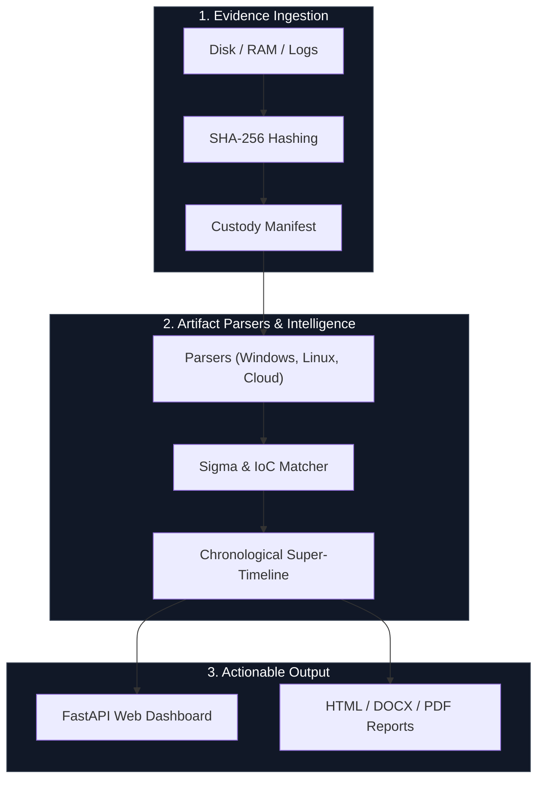

<p align="center">
  
</p>

<p align="center">
  <a href="LICENSE"></a>
  
  
  
</p>

---

## ⚡ Overview

**AllinOneForensics (AIOF)** is an extensible, offline-first Digital Forensics and Incident Response (DFIR) workbench designed for security teams, SOC analysts, and forensic investigators. It streamlines evidence preservation, tamper-evident audit logging, multi-platform artifact parsing, RBAC authorization, and NIST/ISO compliance reporting into a single high-speed Python application.

---

## 🧭 Navigation

- [Quick Start](#-quick-start)
- [Core Features](#-core-features)
- [Architecture & Workflow](#-architecture--workflow)
- [Documentation Hub](#-documentation-hub)
- [Security & Compliance](#-security--compliance)
- [Contributing & License](#-contributing--license)

---

## 🚀 Quick Start

```bash
# Clone the repository
git clone https://github.com/abhiiibabariya-dev/AllinOneForensics.git
cd AllinOneForensics

# Install in editable mode with development dependencies
pip install -e .[dev,windows,memory,yara]

# Create a forensic case
aiof case create --name "Incident-2026-001" --examiner "Lead Analyst"

# Ingest evidence with automatic SHA-256 verification
aiof ingest Incident-2026-001 ./evidence/sample.evtx

# Parse artifacts & run threat correlation
aiof parse Incident-2026-001 --all

# Generate compliance & forensic reports (HTML, DOCX, PDF)
aiof report Incident-2026-001 --format html,docx,pdf

# Launch the interactive FastAPI Web UI dashboard
aiof ui
# Access locally at http://127.0.0.1:8088
```

---

## 🛡️ Core Capabilities

- **Evidence Preservation (`aiof/core/evidence.py`):** Computes cryptographic SHA-256 hashes and maintains immutable chain-of-custody manifests.
- **Tamper-Evident Audit Logging (`aiof/core/audit.py`):** HMAC-SHA256 hash-chained event logs protecting audit trails against undetected tampering.
- **Role-Based Access Control (`aiof/core/rbac.py`):** Enforces strict privilege tiers (`Admin`, `Senior Analyst`, `Junior Analyst`, `Auditor`, `Guest`).
- **Multi-Platform Parsers (`aiof/parsers/`):** Extracts logs, registry hives, and volatile structures across Windows, Linux, memory, and cloud outputs.
- **Threat Intelligence & Sigma (`aiof/analysis/`):** Matches IoCs and correlates behavior against Sigma detection rules and MITRE ATT&CK TTPs.
- **Compliance Center (`aiof/core/compliance.py`):** Generates automated assurance packages mapped to NIST CSF 2.0 and ISO 27001 controls.

---

## 🏗️ Architecture Blueprint



---

## 📚 Documentation Hub

- [Product Audit & Test Validation](docs/PRODUCT_AUDIT.md)
- [Enterprise Deployment Guide](docs/ENTERPRISE_DEPLOYMENT.md)
- [Plugin Development Guide](docs/PLUGIN_DEVELOPMENT.md)
- [Security Policy & Vulnerability Reporting](SECURITY.md)

---

## 🔒 Security & Offline Operation

- **Air-Gapped Design:** Operates fully offline without required external telemetry or cloud egress.
- **Cryptographic Assurance:** Every evidence exhibit and audit log entry is cryptographically bound and verifiable.

---

## 📄 License & Contributing

Distributed under the **Apache-2.0 License**. Contributions, bug reports, and pull requests are welcome. See [CONTRIBUTING.md](CONTRIBUTING.md) for guidelines.
