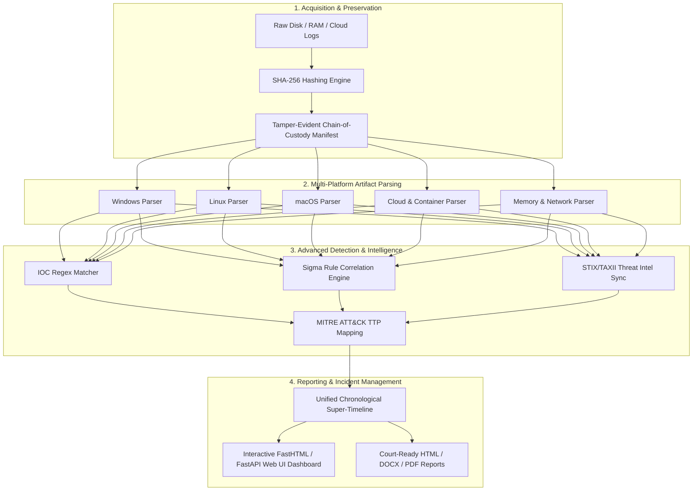

<p align="center">
  <h1 align="center">🛡️ AllinOneForensics (AIOF) 🔬</h1>
  <p align="center"><strong>Enterprise-Grade Digital Forensics, Incident Response (DFIR) & Threat Hunting Workbench</strong></p>
  <p align="center">
    
    
    
    
    
  </p>
</p>

---

## ⚡ Executive Summary

**AllinOneForensics (AIOF)** is a unified, high-performance forensic investigation suite designed for cybersecurity professionals, SOC analysts, and incident responders. Inspired by modern threat hunting platforms (such as DFIR-IRIS) and rigorous NIST SP 800-86 standards, AIOF bridges the gap between raw artifact parsing, cryptographic chain-of-custody preservation, Sigma threat detection, and automated report generation—running 100% offline in air-gapped secure labs.

---

## 📊 Comprehensive Capability Matrix

| Forensic Domain | Supported Artifacts & Engines | Core Capabilities & Analysis Depth |
| :--- | :--- | :--- |
| **🪟 Windows Forensics** | EVTX, Registry Hives, Prefetch, Amcache, LNK, JumpLists, \$MFT, Defender | Timestamp normalization (FILETIME), IOC extraction, process execution tracking |
| **🐧 Linux Forensics** | `/var/log/*`, auth.log, bash_history, cron, systemd, user accounts | Privilege escalation detection, SSH brute-force analysis, unauthorized cron persistence |
| **🍎 macOS Forensics** | Unified Logs, LaunchAgents, LaunchDaemons, browser state | Persistence vector discovery, plist parsing, quarantine flag verification |
| **📱 Mobile & Android** | ADB backups, package manifests, logcat dumps, SMS/Chrome DBs | App permission inspection, unencrypted SQLite artifact extraction |
| **🌐 Network & PCAP** | `.pcap` dumps, DNS queries, HTTP headers, TLS-SNI streams | Beaconing frequency heuristics, C2 communication pattern matching |
| **☁️ Cloud Auditing** | AWS CloudTrail, Azure Activity, GCP Audit JSON logs | Privileged API call tracking, unauthorized cross-region resource creation |
| **🧠 Memory Forensics** | Volatility 3 dumps, raw memory images (`.raw`, `.dmp`, `.img`) | Process enumeration, network socket inspection, RWX memory injection detection |
| **🐳 Container Security** | Kubernetes audit logs, Docker inspect JSON | Unauthenticated API access, dangerous RBAC bindings, privileged host mounts |
| **📧 Email & Malware** | EML/MSG files, headers, static binaries, YARA rules | SPF/DKIM/DMARC validation, YARA signature matching, entropy checks |

---

## 🏗️ End-to-End Investigation Workflow



---

## 💻 Installation & Environment Setup

```bash
# Clone the repository
git clone https://github.com/abhiiibabariya-dev/AllinOneForensics.git
cd AllinOneForensics

# Install in editable mode with development & analysis dependencies
pip install -e .[dev,windows,memory,yara]
```

---

## 🕹️ CLI & Operational Reference

```bash
# 1. Initialize a new forensic case
aiof case create --name "IR-2026-091" --examiner "Senior Forensics Investigator"

# 2. Ingest evidence with automatic SHA-256 chain-of-custody verification
aiof ingest --case IR-2026-091 --path ./evidence/suspect_disk.raw
aiof ingest --case IR-2026-091 --path ./evidence/k8s_audit.json

# 3. Execute multi-platform parsers and intelligence correlation
aiof parse --case IR-2026-091 --all

# 4. Compile court-ready documentation (HTML, DOCX, PDF)
aiof report --case IR-2026-091 --format html,docx,pdf

# 5. Launch the high-performance Web UI Dashboard
aiof ui --case IR-2026-091
# Navigate to: http://127.0.0.1:8088
```

---

## 📺 Live Terminal & Web UI Walkthrough

### ⌨️ CLI Execution Trace
```text
$ aiof parse --case IR-2026-091 --all
[+] Loading forensic case: IR-2026-091
[+] Verifying evidence integrity (SHA-256): 12 files verified (100% intact)
[+] Running Multi-Platform Artifact Parsers (Windows, Linux, macOS, Network, Cloud, Memory)...
[+] Sigma Rule Engine correlated 3 high-severity threat signatures.
[+] MITRE ATT&CK Mapping: T1059.001 (PowerShell), T1078 (Valid Accounts).
[+] Super-timeline generated successfully (1,420 chronological events).
[✓] Analysis complete. Reports stored in: ./cases/IR-2026-091/reports/
```

### 🖥️ Interactive Web UI Dashboard Preview
```text
+-----------------------------------------------------------------------------------------+
| 🛡️ AllinOneForensics (AIOF) Workbench                  Active Case: IR-2026-091         |
+-----------------------------------------------------------------------------------------+
| [ Cases ] [ Evidence & Integrity ] [ Parsers ] [ Super-Timeline ] [ IOCs ] [ Reports ]  |
+-----------------------------------------------------------------------------------------+
| 📊 Case Statistics & Chain of Custody:                                                  |
|   • Total Evidence Items: 12        • SHA-256 Integrity: 100% Verified (0 Modified)     |
|   • High-Severity Findings: 3       • Active IOC Matches: 2                             |
|                                                                                         |
| 🔍 Critical Incident Alerts (Sigma / MITRE ATT&CK Correlated):                          |
|   [HIGH] Sigma/sigma-001: PowerShell Encoded Command Execution (T1059.001)              |
|   [HIGH] Windows/Defender/Threat: Trojan:Win32/Emotet Payload Identified                  |
|   [MED]  Linux/Auth: Failed SSH authentication spike from 192.168.1.50 (T1110)          |
+-----------------------------------------------------------------------------------------+
```

---

## 🔒 Security & Air-Gapped Compliance

- **100% Offline Execution:** Designed specifically for secure, air-gapped forensic workstations. Zero external telemetry egress by default.
- **Cryptographic Verifiability:** Every evidentiary item is fingerprinted upon ingestion, ensuring uncompromised evidentiary chain-of-custody.

---

## 📄 License & Legal Notice

Distributed under the **Apache-2.0 License**. Authorized Digital Forensics and Incident Response (DFIR), security research, and educational engagements only.
