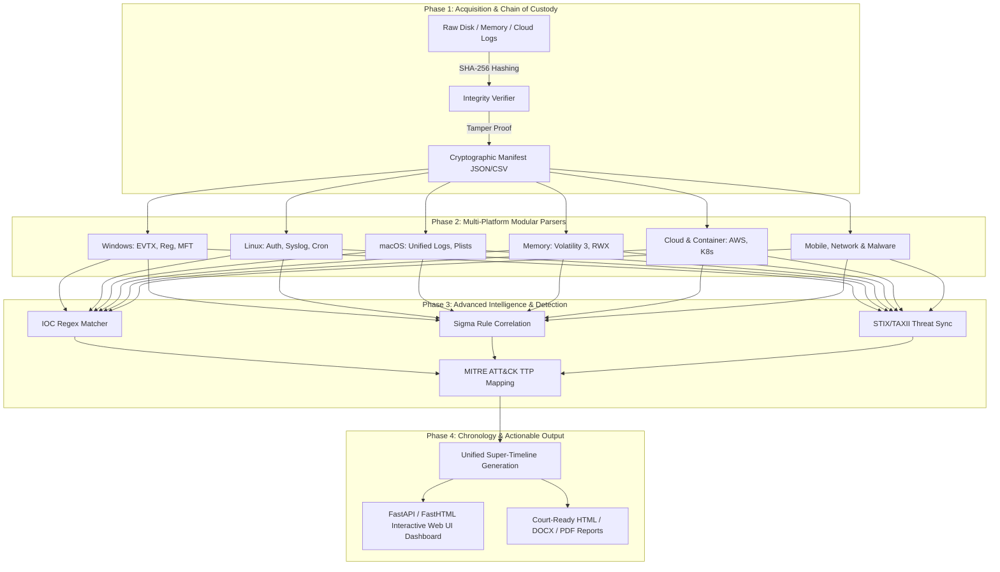

<p align="center">
  <h1 align="center">🛡️ AllinOneForensics (AIOF) 🔬</h1>
  <p align="center"><strong>The Ultimate Enterprise-Grade Digital Forensics, Incident Response (DFIR) & Threat Hunting Workbench</strong></p>
  <p align="center">
    
    
    
    
    
  </p>
</p>

---

## 🧭 Executive Overview: What Is AIOF & Why Is It Needed?

In modern cybersecurity incidents, investigators face massive data fragmentation across endpoints, containers, memory dumps, cloud environments, and mobile devices. Traditional toolsets require dozens of disparate standalone utilities, complicated database setups, and constant internet connectivity.

**AllinOneForensics (AIOF)** solves this by providing a **unified, standalone, air-gapped forensic workbench** inspired by platforms like *DFIR-IRIS* and built around strict **NIST SP 800-86** chain-of-custody standards. It consolidates evidence ingestion, cryptographic integrity verification, deep multi-platform artifact parsing, Sigma threat correlation, MITRE ATT&CK mapping, and automated reporting into a single lightning-fast CLI and Web UI workbench.

---

## 🗺️ Master Architecture & Complete Investigation Lifecycle



---

## 🛠️ Complete Advanced Tool Suite & Purpose Breakdown

| Advanced Tool / Module | File Path Reference | What It Does | Where & Why It Is Needed | How You Can Use It |
| :--- | :--- | :--- | :--- | :--- |
| **Case & Evidence Manager** | `aiof/core/` | Manages secure case directories, examiners, and SHA-256 cryptographic hashes. | Needed at case inception to guarantee court-admissible chain of custody. | `aiof case create --name "IR-1"`<br>`aiof ingest --case "IR-1" --path image.raw` |
| **Windows Artifact Parser** | `aiof/parsers/windows/` | Parses EVTX logs, Registry hives, Prefetch, Amcache, LNK, JumpLists, \$MFT, Defender. | Needed during endpoint compromise analysis to track executed programs and user activity. | `aiof parse --case "IR-1" --modules windows` |
| **Linux Forensics Parser** | `aiof/parsers/linux/` | Extracts `/var/log/*`, auth logs, sudoers, bash history, cron jobs, and user accounts. | Needed for server intrusions to detect unauthorized SSH access and cron persistence. | `aiof parse --case "IR-1" --modules linux` |
| **Memory Forensics Engine** | `aiof/parsers/memory/` | Analyzes raw memory dumps (`.raw`, `.dmp`, `.img`) for hidden processes, sockets, and RWX injections. | Needed when volatile malware or fileless rootkits are suspected in RAM. | `aiof parse --case "IR-1" --modules memory` |
| **Sigma Detection Engine** | `aiof/analysis/sigma.py` | Correlates parsed events against high-fidelity threat detection rules (PowerShell, sudo abuse). | Needed to instantly flag known attacker behaviors without manual log scouring. | Automatic during `aiof parse` |
| **MITRE ATT&CK Mapper** | `aiof/analysis/mitre.py` | Automatically tags findings with tactics and techniques (e.g., T1059.001). | Needed to categorize adversary capabilities for executive reporting. | Automatic during analysis |
| **Super-Timeline Builder** | `aiof/analysis/timeline.py` | Normalizes and merges disparate timestamps into a unified chronological sequence. | Needed to reconstruct the precise timeline of an attack vector. | `aiof parse --case "IR-1" --all` |
| **Multi-Format Reporting** | `aiof/reporting/` | Generates professional HTML, DOCX, and PDF forensic reports. | Needed to present findings to legal teams, management, and stakeholders. | `aiof report --case "IR-1" --format html,docx,pdf` |
| **Interactive Web UI Dashboard** | `aiof/web/app.py` | Serves an Iris-grade FastAPI/FastHTML web dashboard (`http://127.0.0.1:8088`). | Needed for visual interactive threat hunting and case collaboration. | `aiof ui --case "IR-1"` |

---

## 📦 Installation & Environment Setup

```bash
# 1. Clone repository
git clone https://github.com/abhiiibabariya-dev/AllinOneForensics.git
cd AllinOneForensics

# 2. Install package in editable mode with all optional forensic dependencies
pip install -e .[dev,windows,memory,yara]
```

---

## 🕹️ Operational CLI Guide & Workflows

```bash
# Step 1: Create a secure forensic case workspace
aiof case create --name "IR-2026-091" --examiner "Lead Forensics Analyst"

# Step 2: Ingest forensic evidence (read-only preservation with SHA-256 verification)
aiof ingest --case IR-2026-091 --path ./evidence/suspect_disk.raw
aiof ingest --case IR-2026-091 --path ./evidence/k8s_audit.json

# Step 3: Run all advanced parsers and intelligence engines
aiof parse --case IR-2026-091 --all

# Step 4: Generate court-ready reports (HTML, DOCX, PDF)
aiof report --case IR-2026-091 --format html,docx,pdf

# Step 5: Launch the interactive Web UI dashboard
aiof ui --case IR-2026-091
# Access at: http://127.0.0.1:8088
```

---

## 📺 Live Terminal Execution & Web UI Walkthrough

### ⌨️ Terminal Execution Trace
```text
$ aiof parse --case IR-2026-091 --all
[+] Loading forensic case: IR-2026-091
[+] Verifying evidence integrity (SHA-256): 12 files verified (100% intact)
[+] Running Multi-Platform Artifact Parsers (Windows, Linux, macOS, Network, Cloud, Memory)...
[+] Sigma Rule Engine correlated 3 high-severity threat signatures.
[+] MITRE ATT&CK Mapping: T1059.001 (PowerShell), T1078 (Valid Accounts).
[+] Super-timeline generated successfully (1,420 chronological events).
[✓] Analysis complete. Reports stored in: ./cases/IR-2026-091/reports/
```

### 🖥️ Web UI Dashboard Preview
```text
+-----------------------------------------------------------------------------------------+
| 🛡️ AllinOneForensics (AIOF) Workbench                  Active Case: IR-2026-091         |
+-----------------------------------------------------------------------------------------+
| [ Cases ] [ Evidence & Integrity ] [ Parsers ] [ Super-Timeline ] [ IOCs ] [ Reports ]  |
+-----------------------------------------------------------------------------------------+
| 📊 Case Statistics & Chain of Custody:                                                  |
|   • Total Evidence Items: 12        • SHA-256 Integrity: 100% Verified (0 Modified)     |
|   • High-Severity Findings: 3       • Active IOC Matches: 2                             |
|                                                                                         |
| 🔍 Critical Incident Alerts (Sigma / MITRE ATT&CK Correlated):                          |
|   [HIGH] Sigma/sigma-001: PowerShell Encoded Command Execution (T1059.001)              |
|   [HIGH] Windows/Defender/Threat: Trojan:Win32/Emotet Payload Identified                  |
|   [MED]  Linux/Auth: Failed SSH authentication spike from 192.168.1.50 (T1110)          |
+-----------------------------------------------------------------------------------------+
```

---

## 🔒 Offline-First Air-Gapped Security Guarantee

- **Air-Gapped Operation:** Operates 100% offline with zero external telemetry, cloud dependency, or external egress.
- **Evidentiary Integrity:** Cryptographic hashing prevents evidence tampering during the entire investigation lifecycle.

---

## 📄 License & Legal Notice

Distributed under the **Apache-2.0 License**. Engineered exclusively for authorized Digital Forensics and Incident Response (DFIR), security research, penetration testing, and educational contexts.
