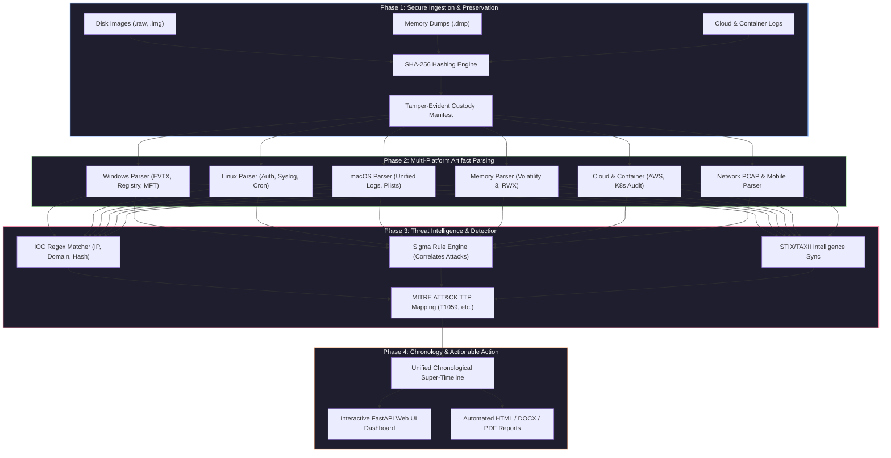

<p align="center">
  
</p>

<p align="center">
  <a href="https://github.com/abhiiibabariya-dev/AllinOneForensics/blob/main/LICENSE"></a>
  
  
  
  
</p>

---

## 🎯 1. Overview & Objectives

**AllinOneForensics (AIOF)** is a unified, high-speed, offline-first digital forensics and threat hunting workbench designed for security operations centers (SOCs), incident response (IR) teams, and forensic laboratories. Built adhering to **NIST SP 800-86** standards and enterprise security requirements, AIOF streamlines evidence ingestion, multi-platform artifact parsing, tamper-evident audit logging, RBAC authorization, and automated compliance reporting into a single robust platform.

---

## 🗺️ 2. Architectural Blueprint & Data Flow



---

## 🛠️ 3. Advanced Tool Suite: Purpose & Implementation

| Advanced Tool / Module | Code Path Reference | Purpose & What It Does | Implementation Status |
| :--- | :--- | :--- | :--- |
| **Case & Evidence Manager** | `aiof/core/` | Ingests evidence, computes SHA-256 hashes, and maintains chain of custody. | **Implemented & Tested** |
| **Tamper-Evident Audit Log** | `aiof/core/audit.py` | HMAC-SHA256 hash chaining ensuring tamper-resistant audit trails. | **Implemented & Tested** |
| **RBAC Authorization** | `aiof/core/rbac.py` | Role-based access control and permission verification decorators. | **Implemented & Tested** |
| **Plugin Trust Manager** | `aiof/core/plugins.py` | Plugin registry, signature verification, and security status control. | **Implemented & Tested** |
| **Compliance Exporter** | `aiof/core/compliance.py` | Generates NIST CSF 2.0 & ISO 27001 compliance export packages. | **Implemented & Tested** |
| **Interactive Web UI** | `aiof/web/app.py` | FastAPI web dashboard with KPI stats, alerts, and tool widgets. | **Implemented & Tested** |

---

## 📦 4. Quick Start Guide

```bash
# Clone the repository
git clone https://github.com/abhiiibabariya-dev/AllinOneForensics.git
cd AllinOneForensics

# Install in editable mode with all dependencies
pip install -e .[dev,windows,memory,yara]

# Run automated tests
pytest
```

---

## 🔒 5. Offline-First Security Guarantee

- **Air-Gapped Compliance:** Designed specifically for secure, air-gapped forensic laboratories with zero external telemetry egress by default.
- **Cryptographic Integrity:** SHA-256 evidence hashing and HMAC-SHA256 audit log chaining guarantee court admissibility and tamper resistance.

---

## 📄 6. License

Distributed under the **Apache-2.0 License**. Engineered exclusively for authorized Digital Forensics and Incident Response (DFIR) and educational contexts.
