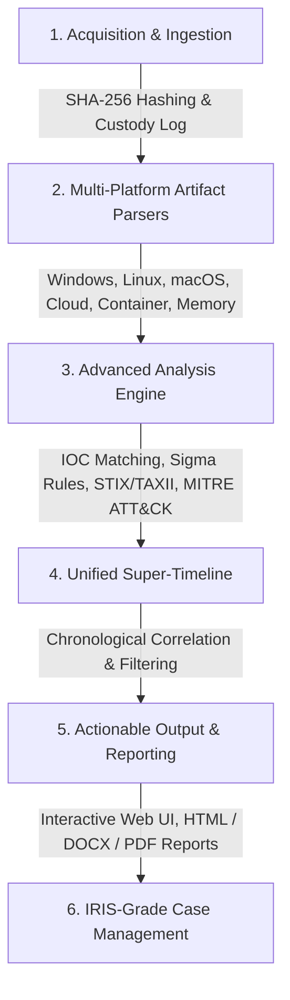

# AllinOneForensics (AIOF) 🛡️🔬

<div align="center">

[](https://opensource.org/licenses/Apache-2.0)
[](https://www.python.org/)
[]()
[]()
[]()

**The Ultimate All-in-One Digital Forensics & Incident Response (DFIR) & Threat Hunting Workbench.**
*Engineered for high-speed host, mobile, network, cloud, container, and memory analysis with cryptographic chain-of-custody verification and Iris-grade incident management.*

</div>

---

## 🏗️ Architecture & NIST SP 800-86 Workflow

AllinOneForensics enforces rigid forensic standards matching the **NIST SP 800-86** incident response lifecycle:



---

## 🚀 Key Features & Enterprise Capabilities

### 1. Cryptographic Chain of Custody & Evidence Integrity
- **SHA-256 Hashing:** Automatic computation and secure logging for every ingested asset.
- **Continuous Integrity Audits:** Detects unauthorized post-acquisition modifications (`verify_evidence_integrity`).
- **Tamper-Evident Manifests:** Export cryptographic JSON & CSV manifests for court-ready proceedings.

### 2. Deep Multi-Platform Artifact Parsers
- **Windows Forensics:** EVTX Event Logs, Registry Hives, Prefetch, Amcache, LNK Files, JumpLists, \$MFT, and Defender telemetry.
- **Linux Forensics:** `/var/log` analysis, auth logs, bash history, cron jobs, systemd services, and user privilege auditing.
- **macOS Forensics:** Unified logs heuristics, LaunchAgents, LaunchDaemons, and application state databases.
- **Android & Mobile:** ADB backup extraction, package inspection, logcat dumps, and unencrypted SMS/Chrome databases.
- **Network & PCAP:** Packet capture ingestion, DNS/HTTP/TLS-SNI extraction, and beaconing frequency analytics.
- **Cloud Auditing:** AWS CloudTrail, Azure Activity, and GCP Audit JSON log correlation.
- **Memory Forensics:** Volatility 3 integration with robust offline string extraction and injection heuristics.
- **Container Security:** Kubernetes audit inspection (unauthenticated access, dangerous RBAC bindings) and Docker inspect privilege analysis.
- **Email & Malware:** EML/MSG header analysis, SPF/DKIM/DMARC checks, and YARA rule signature matching.

### 3. Threat Intelligence & Detection Engineering
- **STIX/TAXII Sync:** Automated ingestion and mapping of STIX 2.x threat intelligence bundles.
- **Sigma Rule Engine:** High-performance event pattern matching against built-in and custom Sigma rules (`aiof/analysis/sigma.py`).
- **MITRE ATT&CK Mapping:** Automatic correlation of findings to adversary tactics, techniques, and procedures (TTPs).

---

## 📦 Installation & Quick Setup

```bash
# Clone the repository
git clone https://github.com/abhiiibabariya-dev/AllinOneForensics.git
cd AllinOneForensics

# Install in editable mode with all dependencies
pip install -e .
```

---

## 🕹️ CLI Quick Start Guide

```bash
# 1. Create a secure forensic case
aiof case create --name "IR-2026-091" --examiner "Lead Analyst"

# 2. Ingest forensic evidence (read-only preservation)
aiof ingest --case IR-2026-091 --path ./evidence/disk_image.raw
aiof ingest --case IR-2026-091 --path ./evidence/k8s_audit.json

# 3. Execute multi-platform parsers and detection engines
aiof parse --case IR-2026-091 --all

# 4. Generate court-ready reports in multiple formats
aiof report --case IR-2026-091 --format html,docx,pdf

# 5. Launch the interactive Web UI Dashboard
aiof ui --case IR-2026-091
# Accessible locally at: http://127.0.0.1:8088
```

---

## 📺 Visual Demo & UI Walkthrough

### Terminal CLI Execution
```text
$ aiof parse --case IR-2026-091 --all
[+] Loading forensic case: IR-2026-091
[+] Verifying evidence integrity (SHA-256): 12 files intact (0 modified)
[+] Running Windows, Linux, macOS, Network, Cloud, and Memory Parsers...
[+] Sigma Rule Engine matched 3 high-severity indicators.
[+] Super-timeline generated successfully (1,420 events).
[✓] Analysis complete. Reports generated: ./cases/IR-2026-091/reports/
```

### Interactive Web UI Dashboard
```text
 +-----------------------------------------------------------------------+
 | AllinOneForensics (AIOF) - Active Case: IR-2026-091                   |
 +-----------------------------------------------------------------------+
 | [Cases] [Evidence & Integrity] [Parsers] [Timeline] [IOCs] [Reports]  |
 +-----------------------------------------------------------------------+
 | 📊 Case Statistics & Evidence Integrity:                              |
 |   - Total Evidence Items: 12   - SHA-256 Verified: 100% Intact        |
 |   - High-Severity Findings: 3  - IOC Matches: 2                       |
 |                                                                       |
 | 🔍 Recent Suspicious Findings:                                        |
 |   [High] Sigma/sigma-001: PowerShell Encoded Command Execution        |
 |   [High] Windows/Defender/Threat: Trojan:Win32/Emotet detected         |
 |   [Med]  Linux/Auth: Failed SSH login attempt from 192.168.1.50       |
 +-----------------------------------------------------------------------+
```

---

## 🔒 Offline-First Air-Gapped Guarantee

AllinOneForensics is architected for **100% air-gapped forensic laboratories**. No external telemetry, phone-home behavior, or cloud egress occurs unless explicitly authorized via `--online`.

---

## 📄 License & Compliance

Distributed under the **Apache-2.0 License**. Developed for authorized Digital Forensics, Incident Response, security research, and educational engagements only.
