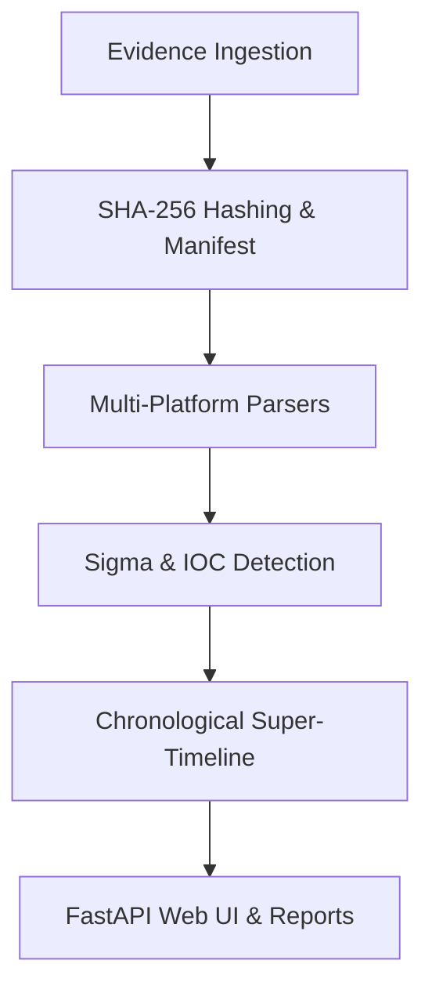

# AllinOneForensics (AIOF)

> Unified Digital Forensics, Incident Response, and Security Investigation Workbench.

[](https://github.com/abhiiibabariya-dev/AllinOneForensics/blob/main/LICENSE)
[](https://www.python.org/)
[](docs/PRODUCT_AUDIT.md)

---

## Navigation

- [Quick Start](#quick-start)
- [Core Features](#core-features)
- [Architecture & Workflow](#architecture--workflow)
- [Documentation & Product Audit](docs/PRODUCT_AUDIT.md)
- [Security & Compliance](SECURITY.md)

---

## Core Features

- **Case & Evidence Management:** Ingest evidence with automatic SHA-256 integrity verification and custody tracking (`aiof/core/`).
- **Tamper-Evident Audit Trails:** HMAC-SHA256 hash-chained event logging ensuring verifiable integrity (`aiof/core/audit.py`).
- **Role-Based Access Control (RBAC):** Granular permission enforcement and decorators (`aiof/core/rbac.py`).
- **Plugin Trust & Verification:** Cryptographic plugin signing and registry management (`aiof/core/plugins.py`).
- **Compliance Reporting:** Export packages mapped to NIST CSF 2.0 and ISO 27001 standards (`aiof/core/compliance.py`).
- **Interactive Web Dashboard:** FastAPI-powered investigator workspace (`aiof/web/app.py`).

---

## Architecture & Workflow



---

## Quick Start

```bash
# Clone repository
git clone https://github.com/abhiiibabariya-dev/AllinOneForensics.git
cd AllinOneForensics

# Install package in editable mode
pip install -e .[dev]

# Run test suite
pytest
```

---

## License

Distributed under the Apache-2.0 License. Designed for authorized digital forensics and incident response.
