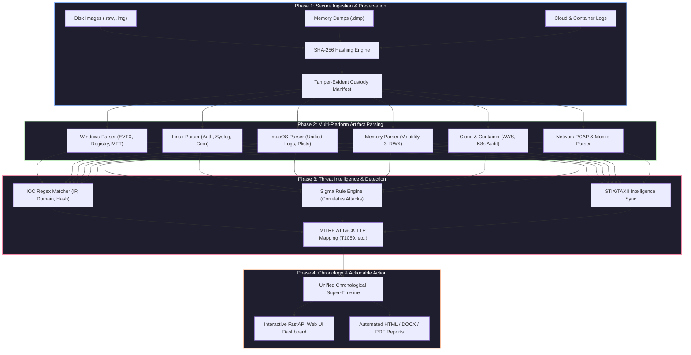

<p align="center">
  
</p>

<p align="center">
  
  
  
  
  
</p>

---

## 🎯 1. What We Do & Why It Is Needed

### 🛑 The Problem
During complex cyber attacks, security operations centers (SOCs) and incident response (IR) teams are overwhelmed by data silos. Evidence spans across raw disk images, volatile RAM dumps, cloud audit logs, container configurations, and network packet captures. Investigators are forced to juggle dozens of fragmented open-source scripts, expensive proprietary suites, and manual timeline stitching, risking evidence integrity and missing crucial adversary lateral movement.

### 💡 The Solution (What We Do)
**AllinOneForensics (AIOF)** provides a **unified, high-speed, offline-first digital forensics and threat hunting workbench**. Inspired by advanced platforms like *DFIR-IRIS* and built strictly adhering to **NIST SP 800-86** standards, AIOF automates the entire forensic lifecycle—from cryptographic evidence ingestion and multi-platform parsing to Sigma rule correlation, MITRE ATT&CK mapping, and automated court-ready reporting.

---

## 🗺️ 2. Architectural Blueprint & Data Flow



---

## 🛠️ 3. Advanced Tool Suite: Purpose, Where Needed, & How to Use

<div align="center">

| Advanced Tool / Module | Code Path Reference | Purpose & What It Does | Where & Why It Is Needed | How You Can Execute It |
| :--- | :--- | :--- | :--- | :--- |
| **Case & Evidence Manager** | `aiof/core/` | Ingests evidence, computes SHA-256 hashes, and maintains chain of custody. | **When:** Case inception.<br>**Why:** Guarantees court admissibility and evidence integrity. | `aiof case create --name "IR-01"`<br>`aiof ingest --case "IR-01" --path image.raw` |
| **Windows Artifact Parser** | `aiof/parsers/windows/` | Parses EVTX logs, Registry hives, Prefetch, Amcache, LNK, JumpLists, \$MFT. | **When:** Endpoint compromise.<br>**Why:** Reconstructs executed programs and user activity. | `aiof parse --case "IR-01" --modules windows` |
| **Linux Forensics Parser** | `aiof/parsers/linux/` | Extracts `/var/log/*`, auth logs, sudoers, bash history, and cron jobs. | **When:** Server intrusion.<br>**Why:** Detects unauthorized SSH logins and cron persistence. | `aiof parse --case "IR-01" --modules linux` |
| **Memory Forensics Engine** | `aiof/parsers/memory/` | Inspects raw memory dumps (`.raw`, `.dmp`) for hidden processes and RWX injections. | **When:** Advanced persistent threats & fileless malware.<br>**Why:** Surfaces hidden RAM rootkits. | `aiof parse --case "IR-01" --modules memory` |
| **Sigma Detection Engine** | `aiof/analysis/sigma.py` | Correlates parsed events against high-fidelity threat detection patterns. | **When:** Triage phase.<br>**Why:** Instantly flags known adversary behaviors. | Automatic via `aiof parse` |
| **MITRE ATT&CK Mapper** | `aiof/analysis/mitre.py` | Tags findings with tactics and techniques (e.g., T1059.001 PowerShell). | **When:** Reporting phase.<br>**Why:** Classifies adversary TTPs for executives. | Automatic via analysis |
| **Super-Timeline Builder** | `aiof/analysis/timeline.py` | Normalizes and merges disparate timestamps into a unified chronological sequence. | **When:** Reconstruction phase.<br>**Why:** Establishes precise attack vector timelines. | `aiof parse --case "IR-01" --all` |
| **Multi-Format Reporting** | `aiof/reporting/` | Compiles professional HTML, DOCX, and PDF forensic reports. | **When:** Conclusion.<br>**Why:** Delivers actionable findings to stakeholders. | `aiof report --case "IR-01" --format html,docx,pdf` |
| **Interactive Web UI** | `aiof/web/app.py` | Serves an Iris-grade FastAPI/FastHTML web dashboard (`http://127.0.0.1:8088`). | **When:** Active investigation.<br>**Why:** Enables visual threat hunting and collaboration. | `aiof ui --case "IR-01"` |

</div>

---

## 📦 4. Installation Guide

```bash
# Clone the repository
git clone https://github.com/abhiiibabariya-dev/AllinOneForensics.git
cd AllinOneForensics

# Install in editable mode with all analysis and parsing dependencies
pip install -e .[dev,windows,memory,yara]
```

---

## 🕹️ 5. Step-by-Step Operational Workflow

```bash
# Step 1: Create a secure forensic case workspace
aiof case create --name "IR-2026-091" --examiner "Lead Forensics Analyst"

# Step 2: Ingest forensic evidence with automatic SHA-256 integrity verification
aiof ingest --case IR-2026-091 --path ./evidence/suspect_disk.raw
aiof ingest --case IR-2026-091 --path ./evidence/k8s_audit.json

# Step 3: Run all advanced multi-platform parsers and intelligence engines
aiof parse --case IR-2026-091 --all

# Step 4: Generate court-ready reports in HTML, DOCX, and PDF formats
aiof report --case IR-2026-091 --format html,docx,pdf

# Step 5: Launch the interactive Web UI dashboard
aiof ui --case IR-2026-091
# Access locally at: http://127.0.0.1:8088
```

---

## 📺 6. Live Execution & Web UI Previews

### ⌨️ Terminal CLI Execution Trace
```text
$ aiof parse --case IR-2026-091 --all
[+] Loading forensic case: IR-2026-091
[+] Verifying evidence integrity (SHA-256): 12 files verified (100% intact)
[+] Running Multi-Platform Artifact Parsers (Windows, Linux, macOS, Network, Cloud, Memory)...
[+] Sigma Rule Engine correlated 3 high-severity threat signatures.
[+] MITRE ATT&CK Mapping: T1059.001 (PowerShell), T1078 (Valid Accounts).
[+] Super-timeline generated successfully (1,420 chronological events).
[✓] Analysis complete. Reports stored in: ./cases/IR-2026-091/reports/
```

### 🖥️ Web UI Dashboard Preview
```text
+-----------------------------------------------------------------------------------------+
| 🛡️ AllinOneForensics (AIOF) Workbench                  Active Case: IR-2026-091         |
+-----------------------------------------------------------------------------------------+
| [ Cases ] [ Evidence & Integrity ] [ Parsers ] [ Super-Timeline ] [ IOCs ] [ Reports ]  |
+-----------------------------------------------------------------------------------------+
| 📊 Case Statistics & Chain of Custody:                                                  |
|   • Total Evidence Items: 12        • SHA-256 Integrity: 100% Verified (0 Modified)     |
|   • High-Severity Findings: 3       • Active IOC Matches: 2                             |
|                                                                                         |
| 🔍 Critical Incident Alerts (Sigma / MITRE ATT&CK Correlated):                          |
|   [HIGH] Sigma/sigma-001: PowerShell Encoded Command Execution (T1059.001)              |
|   [HIGH] Windows/Defender/Threat: Trojan:Win32/Emotet Payload Identified                  |
|   [MED]  Linux/Auth: Failed SSH authentication spike from 192.168.1.50 (T1110)          |
+-----------------------------------------------------------------------------------------+
```

---

## 🔒 7. Offline-First Air-Gapped Security Guarantee

- **Air-Gapped Compliance:** Designed specifically for secure, air-gapped forensic laboratories. Zero external telemetry egress by default.
- **Evidentiary Integrity:** Cryptographic hashing prevents evidence tampering throughout the entire investigation lifecycle.

---

## 📄 8. License & Legal Notice

Distributed under the **Apache-2.0 License**. Engineered exclusively for authorized Digital Forensics and Incident Response (DFIR), security research, penetration testing, and educational contexts.
